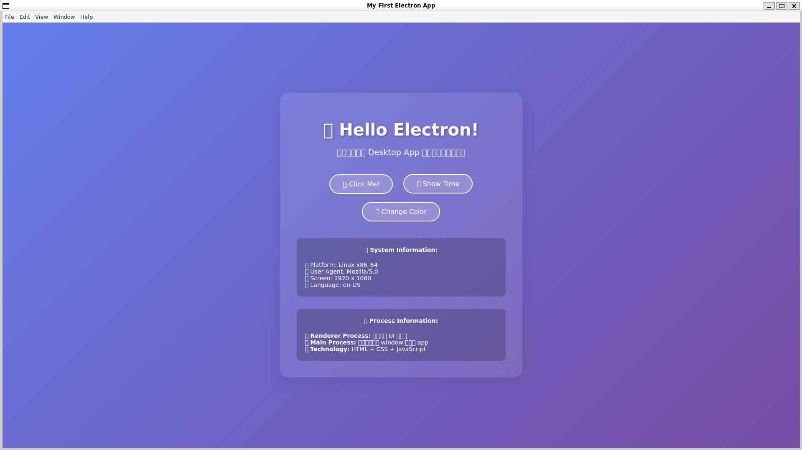
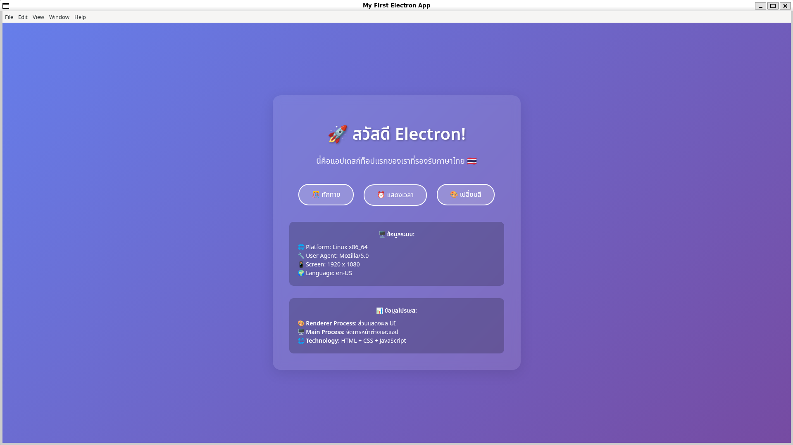
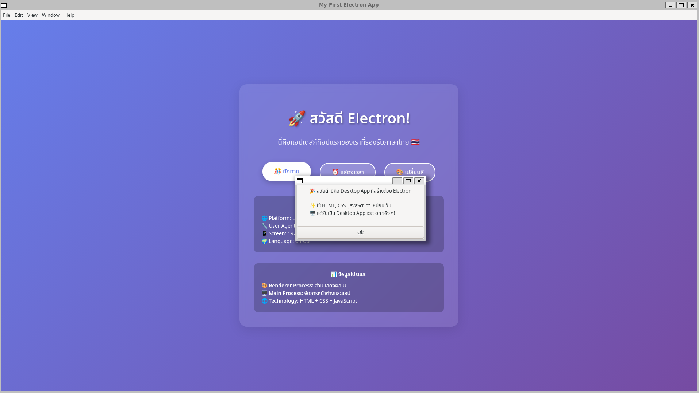
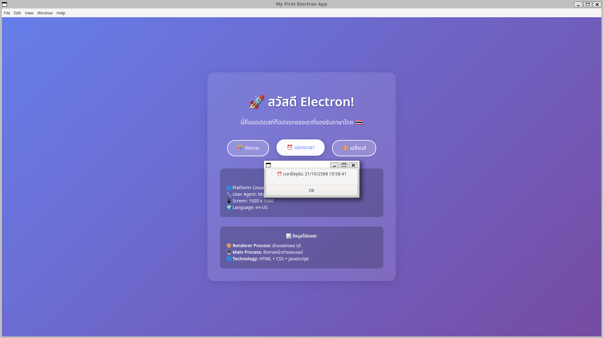
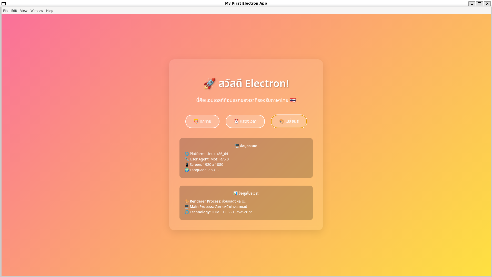

# My First Electron App — Thai & Emoji Ready

**A small cross-platform desktop app built with Electron, with a glassmorphism UI and three interactive actions. It also fixes a real-world problem: Thai text and emoji rendering as empty boxes on Linux/WSL.**


> **ENGSE203, Lab 8.1: Getting started with Electron.** Next: [8.2 IPC communication](https://github.com/tawan230666/Lab-8.2-IPC-Communication) → [8.3 Native APIs](https://github.com/tawan230666/Lab-8.3-Native-APIs-System-Integration).

## The rendering bug I fixed

On Ubuntu/WSL, Electron's bundled Chromium had no font for Thai or colour emoji, so every Thai character showed as a box.

| Before | After |
|---|---|
|  |  |

**Fix:** an explicit font stack (Noto Sans Thai → Sarabun → system fonts), Noto Color Emoji for emoji, and a Twemoji fallback for systems with no emoji font at all.

## Features

| 🎊 Greet | ⏰ Show time (Thai Buddhist calendar) | 🎨 Random gradient background |
|---|---|---|
|  |  |  |

**Security defaults:** `contextIsolation: true` and `nodeIntegration: false`, so web content can't reach Node.js APIs.

## Run

```bash
git clone https://github.com/tawan230666/Lab-8.1-Electron.js.git
cd Lab-8.1-Electron.js
npm install
npm start
```

---

**Author:** Tawan Tiphkun (ธาวัน ทิพคุณ), 67543210033-6, [@tawan230666](https://github.com/tawan230666), Software Engineering, RMUTL Chiang Mai
